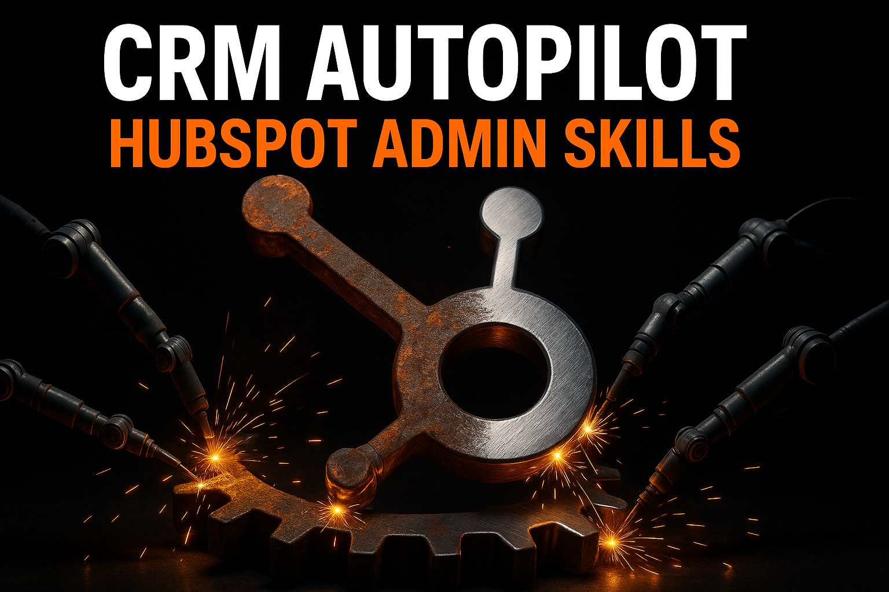

# HubSpot Admin Skills for Claude Code

<p align="center">
  
</p>

**40 Claude Code skills for auditing, cleaning, enriching, and automating your HubSpot CRM, for marketing ops and sales ops alike**

[](https://hubspot.granot.io)
[](./skills/)
[](./LICENSE)
[](https://claude.com/claude-code)

📖 **Browse every skill with full docs at [hubspot.granot.io](https://hubspot.granot.io)** — including [common problems mapped to fixes](https://hubspot.granot.io/problems) and [agent-readable endpoints](https://hubspot.granot.io/install#agents) (`llms.txt`, `skills.json`).

Built by [Tom Granot](https://consume.granot.io) — from deep experience with enterprise HubSpot CRM administration.

---

## What's New in 2.0

- **Marketing and sales audits on one engine.** `/hubspot-marketing-audit` and `/hubspot-sales-audit` join `/hubspot-audit`. All three run the same read-only script with a `--scope` flag. Dimensions are tagged shared, marketing, or sales, and the shared ones run under every scope, so the two teams' reports agree on the numbers they have in common. The sales lens is new: pipeline configuration, deal data quality, stale and past-due deals, ownership and handoff, overdue follow-up.
- **The report prescribes.** Every finding names the skill that fixes it, the report opens with a prioritized list, and a JSON twin sits beside the markdown for `/hubspot-implementation-plan` to read.
- **Service keys, not private apps.** HubSpot disables creating legacy private apps on October 26, 2026. Every skill now asks for a service key and notes that an existing private app token still works.
- **A third connection path.** New `/connect-hubspot-agent-cli` covers HubSpot's Agent CLI (beta), the direct connection for Claude Code: bulk JSONL writes, deletes, property and workflow management. `/connect-hubspot-mcp` is rewritten around how the MCP server actually authenticates, and what it cannot do.
- **Corrected platform facts.** The Workflows API is beta, not stable. There are two API cutoffs, not one. Rate limits depend on tier. The beta Lead Scoring API is documented.
- **Works as an installed plugin.** Script paths are relative to each skill, so commands resolve the same way from the plugin cache as from a clone.
- **Offline tests.** The audit engine has a test suite that runs against a fake HubSpot in CI: no token, no portal.

See [CHANGELOG.md](./CHANGELOG.md) for the full list.

## What's New in 1.2

- **Self-testing, BYO sandbox.** New `/sandbox-self-test` verifies the whole toolkit against a free, disposable HubSpot developer test account you bring: seeded fixtures, read-path smokes for every scripted skill, end-to-end destructive and enrichment cases (mock provider — zero credits), list + v4 workflow round-trips, a graded report, and marker-scoped teardown. Production is locked out in code (account-type gate, fails closed, no override). Optional manual-dispatch CI workflow included.

## What's New in 1.1

HubSpot's platform moved fast in 2026, and this release moves with it:

- **Workflows are API-first.** The four workflow-builder skills *create* their workflows via scripts through HubSpot's Workflows API (always disabled, for review in the UI before enabling) instead of walking you through 40 clicks. Nested branch designs are decomposed into small linear flows the API expresses cleanly. (1.1 called this API stable; HubSpot documents it as beta. Corrected in 2.0.)
- **New `/workflows-as-code`** — export every workflow to versioned JSON, diff exports, restore from backup. HubSpot has no workflow recycle bin; now you have one.
- **Official MCP support.** HubSpot's remote MCP server went GA in April 2026; `/connect-hubspot-mcp` wires it into Claude Code for conversational spot-checks alongside the bulk scripts.
- **New `/waterfall-enrich-contacts`** — external enrichment with pluggable provider adapters (FullEnrich waterfall by default; Apollo, Hunter, Dropcontact included; bring your own), cost caps, and a no-overwrite safety model.
- **New `/audit-api-usage`**: HubSpot switched to date-based API versioning and is retiring v1–v4. This skill finds everything in your stack that needs migrating.
- **Lead scoring refreshed** for the post-2025 scoring tool (Fit + Engagement scores, decay, API-readable score properties), plus repo-wide consistency fixes — one env var, one Python house style, scripts linked from every skill. See [CHANGELOG.md](./CHANGELOG.md).

---

## Connecting to HubSpot

The skills use three complementary connection paths:

1. **Service key + scripts (the default).** Every scripted skill runs plain-Python `requests` against HubSpot's REST APIs using a service key (`HUBSPOT_ACCESS_TOKEN` in `.env`; a token from an existing legacy private app also works). This is the path for anything repeatable or destructive at scale: pagination, rate-limit handling, abort thresholds, and CSV audit trails.
2. **HubSpot's remote MCP server (optional, interactive).** Connect Claude to `mcp.hubspot.com` for conversational reads and spot-checks ("show me 5 contacts this cleanup touched") without writing a script. It cannot delete records or touch workflows. Run `/connect-hubspot-mcp` to set it up.
3. **HubSpot's Agent CLI (optional, beta).** The direct connection for Claude Code: bulk JSONL writes, deletes, property and workflow management from the terminal, with dry runs. Use it for one-off administrative jobs no scripted skill covers. Run `/connect-hubspot-agent-cli`.

Rule of thumb: MCP to look, scripts to change at scale, the CLI for the long tail.

## Self-Testing (Bring Your Own Sandbox)

Before trusting any of this with production, make the toolkit prove itself on a disposable portal:

1. Create a free **developer test account** (HubSpot Settings > Testing > Developer test accounts — every account gets up to 10, no plan required).
2. Create a service key inside it and put its token in `.env` as `HUBSPOT_SANDBOX_ACCESS_TOKEN`.
3. Run `/sandbox-self-test`.

The suite seeds synthetic fixtures (one defect per testable skill), smoke-tests every scripted skill's read path, runs destructive and enrichment cases end-to-end (enrichment uses a mock provider — no credits), round-trips a list and a v4 workflow, writes a PASS/FAIL/SKIP report to `reports/`, and tears everything down. It **hard-refuses to run against anything that isn't a `DEVELOPER_TEST` or `SANDBOX` portal** — the account-type check is enforced in every script, fails closed, and has no override. An opt-in GitHub Actions workflow (manual dispatch only) ships at `skills/sandbox-self-test/ci/` — copy it into `.github/workflows/` to run the suite in CI.

## Quick Start

### 1. Install

```bash
# Add the marketplace
/plugin marketplace add tomgranot/hubspot-admin-skills

# Install the plugin
/plugin install hubspot-admin@hubspot-admin-skills
```

Or clone directly: `git clone https://github.com/TomGranot/hubspot-admin-skills.git`

### 2. Audit your portal

```
/hubspot-audit
```

This scans your entire HubSpot portal — contacts, companies, deals, engagement, deliverability, data quality, duplicates, owners, lists, workflows — and produces a graded report. Each finding gets a severity rating (A-F) and is mapped to the specific skill that fixes it.

Own only one side of the portal? Run `/hubspot-marketing-audit` or `/hubspot-sales-audit` instead. Same engine, same shared numbers, scoped to what your team can act on.

### 3. Get your cleanup plan

```
/hubspot-implementation-plan
```

Reads your audit report and generates a phased roadmap: what to fix, in what order, which skill to run, how long it takes, and what can be automated vs. what needs manual UI work. The plan sequences tasks by dependency — you can't score leads before enriching company data, and you can't build ICP tiers before standardizing industries.

### 4. Execute skill by skill

The plan tells you exactly which slash command to run next. Each skill follows a 4-stage pattern:

| Stage | What happens |
|-------|-------------|
| **Plan** | Explains the approach, asks you for any configuration needed |
| **Before** | Audits current state, exports CSV baseline, shows you what will change |
| **Execute** | Makes the changes (API scripts or step-by-step UI instructions) |
| **After** | Verifies the fix, compares before/after, confirms success |

Skills that can be scripted include ready-to-run Python scripts (plain `requests`, run with `uv run` — no project setup needed). Skills that require HubSpot UI work (lead scoring, some workflow options) provide precise build instructions.

### 5. Maintain

Once clean, use `/weekly-cleanup-routine` (5 min/week) and `/quarterly-database-cleanup` to keep it that way. The audit skill detects issues that no existing skill covers and offers to create new ones on the spot.

---

## Skills Reference

### Audit & Planning (8)

| Skill | Description |
|-------|-------------|
| [`hubspot-audit`](https://hubspot.granot.io/skills/hubspot-audit) | Full read-only portal audit across the marketing and sales sides, graded, with a prioritized prescription of skills to run |
| [`hubspot-marketing-audit`](https://hubspot.granot.io/skills/hubspot-marketing-audit) | The marketing lens: deliverability, contact completeness, engagement, lifecycle consistency, and list, workflow, and form sprawl |
| [`hubspot-sales-audit`](https://hubspot.granot.io/skills/hubspot-sales-audit) | The sales lens: pipeline configuration, deal data quality, stale and past-due deals, ownership and handoff gaps, overdue follow-up |
| [`hubspot-implementation-plan`](https://hubspot.granot.io/skills/hubspot-implementation-plan) | Generate a phased plan from a full, marketing, or sales audit report, with dependencies and effort estimates |
| [`connect-hubspot-mcp`](https://hubspot.granot.io/skills/connect-hubspot-mcp) | Connect Claude to HubSpot's remote MCP server for conversational lookups and spot-checks |
| [`connect-hubspot-agent-cli`](https://hubspot.granot.io/skills/connect-hubspot-agent-cli) | Connect Claude Code to HubSpot's Agent CLI (beta) for bulk and administrative work from the terminal |
| [`audit-api-usage`](https://hubspot.granot.io/skills/audit-api-usage) | Find every integration on legacy v1–v4 endpoints or a legacy private app before HubSpot's 2027 cutoffs |
| [`sandbox-self-test`](https://hubspot.granot.io/skills/sandbox-self-test) | Verify the whole toolkit against a disposable developer sandbox you bring — seed, test, report, tear down; production-locked |

### Database Hygiene (6)

| Skill | Description |
|-------|-------------|
| [`delete-no-email-contacts`](https://hubspot.granot.io/skills/delete-no-email-contacts) | Identify and delete contacts that have no email address — unusable records that inflate your database |
| [`suppress-hard-bounced`](https://hubspot.granot.io/skills/suppress-hard-bounced) | Suppress contacts with hard-bounced email addresses to protect sender reputation |
| [`suppress-global-unsubscribes`](https://hubspot.granot.io/skills/suppress-global-unsubscribes) | Suppress globally unsubscribed contacts to ensure compliance and reduce wasted marketing spend |
| [`suppress-ghost-contacts`](https://hubspot.granot.io/skills/suppress-ghost-contacts) | Find and suppress ghost contacts — records with no activity, no engagement, and no business value |
| [`merge-duplicate-companies`](https://hubspot.granot.io/skills/merge-duplicate-companies) | Detect and merge duplicate company records using domain matching and fuzzy name comparison |
| [`reassign-deactivated-owners`](https://hubspot.granot.io/skills/reassign-deactivated-owners) | Reassign contacts and deals owned by deactivated HubSpot users to active team members |

### Data Enrichment (6)

| Skill | Description |
|-------|-------------|
| [`enrich-company-name`](https://hubspot.granot.io/skills/enrich-company-name) | Populate missing company names on contacts by pulling from their associated company records |
| [`enrich-industry`](https://hubspot.granot.io/skills/enrich-industry) | Backfill contact industry values from associated company industry data |
| [`standardize-geo-values`](https://hubspot.granot.io/skills/standardize-geo-values) | Normalize country and state/region values to consistent formats across your database |
| [`assign-unowned-contacts`](https://hubspot.granot.io/skills/assign-unowned-contacts) | Assign marketing contacts that have no owner to the appropriate team members based on territory or segment rules |
| [`fix-lifecycle-stages`](https://hubspot.granot.io/skills/fix-lifecycle-stages) | Detect and correct lifecycle stage violations — contacts stuck in the wrong stage or regressed backwards |
| [`waterfall-enrich-contacts`](https://hubspot.granot.io/skills/waterfall-enrich-contacts) | Enrich emails, phones, and titles via external providers — FullEnrich waterfall by default, Apollo/Hunter/Dropcontact included, or bring your own |

### Segmentation & Scoring (3)

| Skill | Description |
|-------|-------------|
| [`create-icp-tiers`](https://hubspot.granot.io/skills/create-icp-tiers) | Create an ICP (Ideal Customer Profile) tier property and assign tier values based on firmographic criteria |
| [`build-lead-scoring`](https://hubspot.granot.io/skills/build-lead-scoring) | Design and implement a lead scoring model in HubSpot's Lead Scoring tool — separate Fit and Engagement scores with decay |
| [`build-smart-lists`](https://hubspot.granot.io/skills/build-smart-lists) | Build active smart lists for key segments — ICP tiers, lifecycle stages, engagement levels, and suppression groups |

### Automation Workflows (5)

All four builders create their workflows via HubSpot's Workflows API, which is still beta (always disabled, for UI review before enabling), with a manual UI path as fallback.

| Skill | Description |
|-------|-------------|
| [`new-contact-hygiene-workflow`](https://hubspot.granot.io/skills/new-contact-hygiene-workflow) | Build a workflow that screens new contacts on creation — validates email, enriches data, and assigns owners |
| [`engagement-suppression-workflow`](https://hubspot.granot.io/skills/engagement-suppression-workflow) | Create a two-tier sunset system that re-engages dormant contacts before suppressing them |
| [`lifecycle-progression-workflow`](https://hubspot.granot.io/skills/lifecycle-progression-workflow) | Set up automated lifecycle stage progression based on engagement thresholds and sales activity |
| [`bounce-monitoring-workflow`](https://hubspot.granot.io/skills/bounce-monitoring-workflow) | Build workflows that monitor bounce events and auto-suppress contacts exceeding bounce thresholds |
| [`workflows-as-code`](https://hubspot.granot.io/skills/workflows-as-code) | Export all workflows to versioned JSON, diff exports over time, and restore workflows from backup |

### Ongoing Maintenance (12)

| Skill | Description |
|-------|-------------|
| [`quarterly-database-cleanup`](https://hubspot.granot.io/skills/quarterly-database-cleanup) | Run a quarterly hygiene sweep — re-audit contacts, prune stale records, and refresh suppression lists |
| [`review-bounced-contacts`](https://hubspot.granot.io/skills/review-bounced-contacts) | Review contacts with 3+ bounces and decide on suppression or re-verification |
| [`cleanup-lists`](https://hubspot.granot.io/skills/cleanup-lists) | Audit and archive unused, redundant, or stale lists cluttering your portal |
| [`cleanup-forms`](https://hubspot.granot.io/skills/cleanup-forms) | Review forms for unused, broken, or duplicate entries and recommend consolidation |
| [`cleanup-workflows`](https://hubspot.granot.io/skills/cleanup-workflows) | Identify workflows that are off, broken, or redundant and recommend which to archive or fix |
| [`weekly-cleanup-routine`](https://hubspot.granot.io/skills/weekly-cleanup-routine) | A repeatable weekly checklist covering the highest-impact maintenance tasks |
| [`cleanup-dashboards`](https://hubspot.granot.io/skills/cleanup-dashboards) | Audit dashboards for unused, duplicate, or outdated reports and recommend consolidation |
| [`cleanup-deals`](https://hubspot.granot.io/skills/cleanup-deals) | Review deal pipeline hygiene — stale deals, missing properties, and stage violations |
| [`cleanup-properties`](https://hubspot.granot.io/skills/cleanup-properties) | Find unused, duplicate, or poorly named contact/company/deal properties and recommend cleanup |
| [`cleanup-lead-owners`](https://hubspot.granot.io/skills/cleanup-lead-owners) | Audit lead owner assignments for imbalances, orphaned records, and routing issues |
| [`backfill-geo-data`](https://hubspot.granot.io/skills/backfill-geo-data) | Backfill missing country and state values using IP geolocation, form submissions, and company data |
| [`create-segment-lists`](https://hubspot.granot.io/skills/create-segment-lists) | Create a standard set of segment lists for reporting, targeting, and suppression |

---

## Prerequisites

- **Claude Code** installed and configured
- **HubSpot account** with a service key in `.env` as `HUBSPOT_ACCESS_TOKEN` (Settings > Integrations > Service Keys; a token from an existing legacy private app also works). Typical scopes across the skill set: `crm.objects.contacts.read/write`, `crm.objects.companies.read/write`, `crm.objects.deals.read/write`, `crm.objects.owners.read`, `crm.schemas.*` (property management), `crm.lists.read/write`, `automation` (workflow skills), `forms` — grant per skill as documented in each SKILL.md
- **Python 3.10+** with [uv](https://github.com/astral-sh/uv) — scripts carry inline metadata and run with `uv run`, no project setup
- HubSpot **Marketing Professional** plan or higher (for workflow-based skills)
- Optional: HubSpot's **MCP server** for conversational spot-checks (`/connect-hubspot-mcp`) and **Agent CLI** for one-off bulk jobs (`/connect-hubspot-agent-cli`)
- Optional: an **enrichment provider** API key (FullEnrich, Apollo, Hunter, Dropcontact, or your own) for `/waterfall-enrich-contacts`
- Optional: a free **developer test account** with its token in `HUBSPOT_SANDBOX_ACCESS_TOKEN` for `/sandbox-self-test`

### API versioning

Scripts target `/crm/v3/`, `/automation/v4/`, and `/marketing/v3/`. These work today. HubSpot's current date-based version is `2026-09`; v4 support ends **March 30, 2027**, and v1–v3 have been unsupported since September 2026 with enforcement in **September 2027**. The scripts migrate to date-based paths one skill at a time, each verified through `/sandbox-self-test`, because not every v3 contract carries over unchanged. `/audit-api-usage` helps you migrate everything else in your stack.

---

## Directory Structure

```
hubspot-admin-skills/
├── README.md
├── CLAUDE.md
├── CONTRIBUTING.md
├── CHANGELOG.md
├── LICENSE
├── .gitignore
├── assets/
│   └── hero.png
├── .claude-plugin/
│   ├── marketplace.json
│   └── plugin.json
└── skills/
    ├── hubspot-audit/
    │   ├── SKILL.md
    │   └── scripts/
    │       └── audit_portal.py
    ├── hubspot-implementation-plan/
    │   └── SKILL.md
    ├── delete-no-email-contacts/
    │   ├── SKILL.md
    │   └── scripts/
    │       ├── before.py
    │       ├── execute.py
    │       └── after.py
    ├── suppress-hard-bounced/
    │   ├── SKILL.md
    │   └── scripts/
    │       ├── before.py
    │       └── after.py
    ├── waterfall-enrich-contacts/
    │   ├── SKILL.md
    │   └── scripts/
    │       ├── before.py / execute.py / after.py
    │       └── providers/           (fullenrich, apollo, hunter, dropcontact, _template)
    ├── sandbox-self-test/
    │   ├── SKILL.md
    │   ├── ci/
    │   │   └── sandbox-self-test.yml   (opt-in workflow — copy to .github/workflows/)
    │   └── scripts/
    │       └── preflight.py / seed.py / run_suite.py / teardown.py
    ├── ...                        (40 skills total, 21 with scripts)
    └── backfill-geo-data/
        └── SKILL.md
```

---

## Community-Driven: Help Build the Skill Set

Every HubSpot portal is different. The audit skill will automatically detect issues that aren't covered by existing skills and **offer to create new ones on the spot**. When it does, it will ask:

> *"Would you like to contribute this new skill back to the community? It will help other HubSpot admins facing the same issue."*

If you say yes, Claude Code will create the skill, push it to your fork, and open a PR — all automatically. You don't need to know git or write markdown.

### Manual Contributing

See [CONTRIBUTING.md](./CONTRIBUTING.md) for the full skill template, frontmatter spec, Python house style, safety-mechanism requirements, and category list. The short version:

1. **Fork**: `gh repo fork TomGranot/hubspot-admin-skills --clone`
2. **Branch**: `git checkout -b skill/your-skill-name`
3. **Create**: Add `skills/<your-skill>/SKILL.md` following the 4-stage pattern (**Plan** → **Before** → **Execute** → **After**, plus **Rollback**)
4. **Test**: Run the skill against a HubSpot sandbox portal
5. **PR**: `gh pr create --repo TomGranot/hubspot-admin-skills`

Please keep skills generic and company-agnostic. No customer data, API keys, or proprietary information.

---

## Author

Created by **[Tom Granot](https://consume.granot.io)**. Built from extensive experience administering HubSpot CRM at scale.

---

## License

MIT -- see [LICENSE](./LICENSE) for details.
